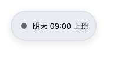

# Clock-out Countdown

> A floating workday companion for the DeepSeek Harness Web UI: clock in, count down, get reminded when it is time to clock out.

[中文](README.md) | **English**

A small pill in the corner of the interface that walks a workday with you: it prompts you to clock in when your shift starts, counts down quietly, turns amber as the end approaches, and fills with colour, breathes and shakes when it is time to leave.

| Clock in | Countdown |
| :---: | :---: |
|  |  |

| Heads-up | Time to leave |
| :---: | :---: |
|  |  |

| Off the clock |
| :---: |
|  |

## Features

- **Clock in** — at your shift's start time the pill shows a "Clock in" button, which is itself the reminder to do it. One click covers the whole day; a refresh or restart remembers it.
  - The button names the **action** (Clock in), not the state (Clocked in) — it is asking you to press it, not reporting.
- **Countdown** — after clocking in it counts down quietly in the corner.
- **Heads-up** — inside the lead window (15 minutes by default) the border and the countdown switch to a warning colour.
- **Clock-out reminder** — the whole card fills with your accent colour, breathes and shakes, and a "Got it" button dismisses it for the day.
  - Shown whether or not you clocked in: forgetting to clock in must not cost you the one reminder that matters most.
- **Reminder window** — the reminder lasts a bounded time (4 hours by default), then goes quiet, so an 18:00 finish does not nag you at midnight.
- **Always there, never in the way** — outside a shift the pill dims and names when you are next on: "Starts today at 09:00" before the shift, "Starts tomorrow at 09:00" after it, "Starts on Monday at 09:00" at the weekend. It stays visible, draggable and clickable, so you never wonder whether the plugin is broken. Only switching "Show the pill" off hides it.
- **Night shifts** — a start time later than the end time is a shift that crosses midnight. At 01:00 the pill correctly recognises the shift that began at 22:00 the evening before.
- **Custom colours** — nine presets plus any colour you pick, with light/dark fills chosen automatically and the text colour derived for contrast.
- **Free dragging** — drag the pill anywhere and it stays there. The position survives a window resize instead of drifting off-screen.
- **Two places to configure** — the gear beside the pill, or this plugin's page under Plugins. Either one opens the same form.

## Install

**Desktop app (DeepSeek Harness):** Plugins page → Add plugin → Install a third-party plugin → enter the package name `dsh-offwork-countdown`. The Desktop profile belongs to the app and cannot be written from the CLI, so this is the only route there.

**Command line:** `--profile` is required; replace `web` with your own profile name.

```bash
dsh plugin --profile web add dsh-offwork-countdown
```

Both routes go live immediately. Replacing an already-installed copy needs a Harness restart to load the new module.

## Usage

1. When your shift starts, the "Clock in" button appears in the corner. Click it to start the countdown.
2. Drag the pill wherever it is out of your way; the position is remembered.
3. Click the gear to adjust: shift times, lead time, breathing pace (1.2 / 1.8 / 3 s), reminder window, weekdays, colour, position, and visibility.

Settings live in `~/.dsh/offwork-countdown/state.json` (honouring `DSH_HOME`).

One thing worth knowing: the clock-out reminder does **not** depend on clocking in — someone who forgot still gets reminded at the end of the day, they just do not see the countdown during it.

## Language

The UI ships Chinese and English text and follows DSH's Settings → General → Language.

If the locale service is unavailable (plugin not active, or the service failed), the fallback consults the system language first (`navigator.language`, which in the Desktop build is Electron's system language) rather than always showing English.

## License

[MIT](LICENSE)
