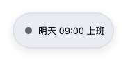

# 下班打卡倒计时

> 悬浮在 DeepSeek Harness Web 界面角落的工作日流程挂件：上班打卡、下班倒计时、到点提醒。

[English](README.en.md) | **中文**

一个挂在界面角落的小胶囊，按你的班次走完一天：到上班时间提醒打卡，打卡后安静倒计时，快下班时换成警告色，到点后整块变色、呼吸、抖动 —— 提醒你别忘了打卡。

| 上班打卡 | 下班倒计时 |
| :---: | :---: |
|  |  |

| 快下班了 | 下班提醒 |
| :---: | :---: |
|  |  |

| 班次之外 |
| :---: |
|  |

## 功能

- **上班打卡** —— 到设定的上班时间，挂件显示「打卡」按钮，这本身就是提醒你要打卡。点一次记一整天，刷新、重开都记得；改了上下班时间相当于换了一个班次，需要重新点一次。
  - 按钮写的是**动作**（打卡），不是状态（已打卡）—— 它要你点，不是在汇报。
- **下班倒计时** —— 打卡后开始倒计时，安静地待在角落。
- **快下班了** —— 进入提前提醒窗口（默认 15 分钟），边框和倒计时换成警告色。
- **下班提醒** —— 到点后整张卡片填满提醒色、呼吸、抖动，并给出「知道了」按钮。点一下当天收起。
  - 无论是否打过卡都会提醒 —— 忘了打卡不该让你错过最重要的那条提醒。
- **提醒有效期** —— 下班后最多提醒一段时间（默认 4 小时），超时自动安静，不会半夜还挂着。
- **一直在，但不打扰** —— 班次之外浮窗变成淡色一条，写清下一次上班时间：上班前「今天 09:00 上班」，下班后「明天 09:00 上班」，周末「周一 09:00 上班」。始终看得见、能拖能点，不会让你怀疑插件坏了。只有关掉「显示浮窗」才会彻底隐藏。
- **夜班支持** —— 上班时间晚于下班时间即视为跨零点班次。凌晨 1 点时，挂件会正确识别这是昨晚 22:00 开始的那个班。
- **颜色自定义** —— 9 个内置色 + 任意自定义色，按浅色/深色主题自动调整明暗，文字颜色自动推导保证可读。
- **自由拖拽** —— 把浮窗拖到任意位置，松开即记住；窗口缩放后仍停在原来的相对位置，不会跑到屏幕外。
- **两处都能设置** —— 点胶囊边上的齿轮，或到「插件」页找到本插件（设置就在标题下方），改哪边都一样。

## 安装

**桌面版（DeepSeek Harness App）**：插件页 → 添加插件 → 安装第三方插件 → 填包名 `dsh-offwork-countdown`。桌面版的 profile 由 App 独占管理，命令行装不进去，只能走这条。

**命令行**：`--profile` 是必填的，换成你自己的 profile 名（常见是 `web`）。

```bash
dsh plugin --profile web add dsh-offwork-countdown
```

两种方式都是装完立即生效；替换已安装的同名包需要重启 Harness 才加载新代码。

## 使用

1. 到上班时间，角落出现「打卡」按钮，点一下开始倒计时。
2. 拖动胶囊到顺手的位置，位置会记住。
3. 点齿轮调整：上班/下班时间、提前提醒分钟数、呼吸节奏（1.2/1.8/3 秒）、提醒有效期、提醒日、颜色、位置、是否显示。

设置存在 `~/.dsh/offwork-countdown/state.json`（尊重 `DSH_HOME`）。

一个小提示：下班提醒**不依赖**打卡 —— 忘了打卡的人到点照样会被提醒，但白天看不到倒计时。

## 语言

界面文案有中英两套，跟随 DSH 的「设置 → 通用 → 语言」。

若页面拿不到 locale 服务（插件未激活或服务异常），回退顺序是**先看系统语言**（桌面版即 Electron 的系统语言），中文系统给中文，其余给英文。

## 协议

[MIT](LICENSE)
